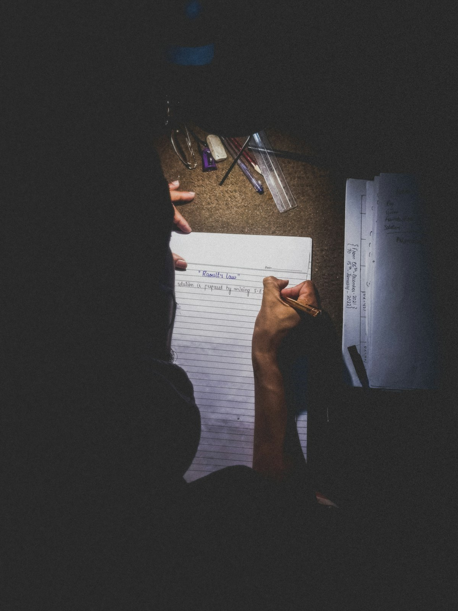
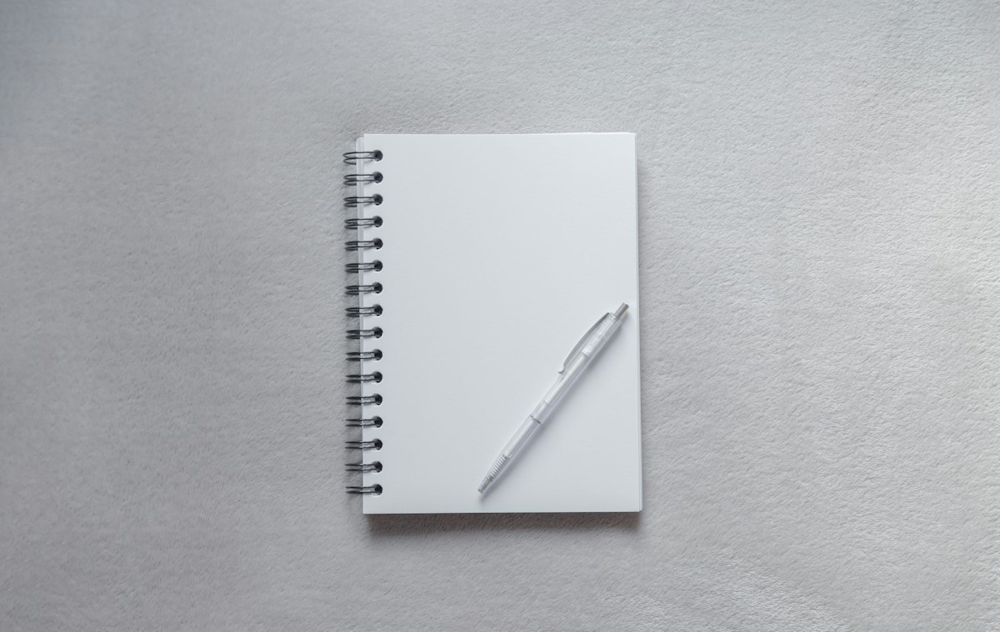
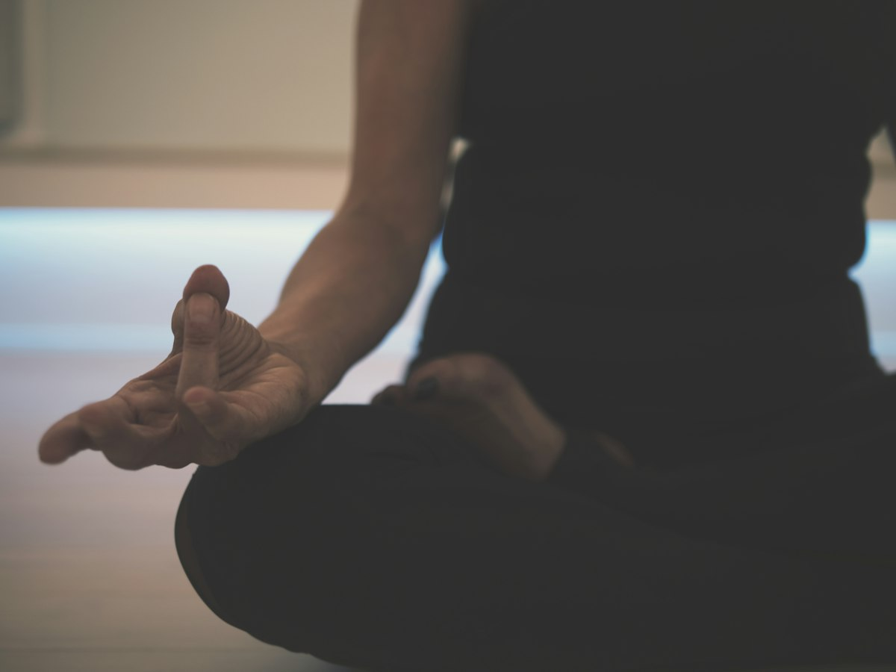

# CSAT D-19: A Condition and Mindset Guide for the Last 3 Weeks (Checklist for Students and Parents)

> Naver Blog draft (saved as a temporary draft, not published). The original post is written in Korean; this file is the English version. Images are from Unsplash (free license) and stored in `images/`.

## [Mindset at D-19]

Today is October 31. Based on news reports, the CSAT (Thursday, November 19) is 19 days away. At this point it is easy to panic-buy a new workbook or rewrite the whole study plan. But the most important thing now is not adding something new. It is organizing body and mind so you can use what you have already built on the day of the exam. Doing today's work as usual is enough.

## [The Next 2-3 Weeks: Sleep, Meals, Routine]

- Sleep: 6-8 hours a day, ideally in bed before midnight. A professor at Seoul St. Mary's Hospital was reported as saying that suddenly lengthening or shortening sleep can break your rhythm. From now on, adjust gradually and steadily toward your exam-day wake-up time.
- Meals: Avoid new foods and greasy "health tonic" meals; stick to what you usually eat. Cut back on late-night snacks, excess caffeine, and energy drinks.
- Routine: Stretch lightly every 1-2 hours. Matching your study hours to the real exam timetable also helps your body adapt.

## [Checklist for the Day Before]

The day before, pick up your admission ticket at the preliminary roll call and check the exam site and room location in person.
- Make sure the admission ticket and a physical ID are in your bag.
- Only analog watches without communication, payment, or electronic-display features are listed as allowed, so double-check.
- Mobile phones, smartwatches, smart glasses, power banks, and similar items are prohibited. Always confirm the details in the official notice.
- If you lose your admission ticket, bring one photo identical to the one on your application and your ID, and report to the exam-site management office by 08:00 on the day to get a replacement.
- Rather than solving new problems, lightly review your wrong-answer notes and summaries, and go to bed at your usual time.

## [Exam Morning and Break Times]

Finish eating about 2 hours before the exam, and eat your usual food at about two thirds of your normal portion. This is advice from a Seoul Asan Medical Center professor reported in the news. A heavy stomach breaks concentration, so don't overdo it.
Based on a private summary, check-in closes at 08:10 and period 1 starts at 08:40, but this is not officially confirmed. One source says periods 2-5 require check-in 10 minutes before the start; be sure to check the full timetable in the official Korea Institute for Curriculum and Evaluation notice. Arriving early is the best condition management.
During breaks, don't re-grade the subject you just finished. Let the finished exam go, drink some water, loosen up lightly, and prepare only for the next period. Check the official notice for rules on the score-check sheet.

## [When You Feel Nervous: Breathing]

When you feel tense, try abdominal breathing.
- Breathe in slowly through your nose and feel your belly expand.
- Breathe out slowly through your mouth, longer than you breathed in.
- Repeat a few times and relax your shoulders.
If you are so tense that you feel dizzy, don't tough it out alone: tell the proctor and settle down. This is general advice based on medical professionals' tips, and it can vary with individual health; if you are very worried, consult a specialist.

## [Guide for Parents]

Good things to do
- Keep a calm, normal attitude
- Say a warm "You've worked so hard"
- Help them leave early enough to arrive within the check-in time
- Check the exam site location and the admission ticket together the day before
Things to avoid
- Stressing "don't make mistakes"
- Comparing with other students
- Overreacting to their health
- Nagging the day before
A parent's calm face is the most reassuring support for a child.

## [Cheering You On]

Simply having kept your seat at the desk day after day has already been a great achievement. The remaining 19 days are a time to protect that effort by sleeping well, eating well, and living as usual. To the students, and to the parents worrying beside them, I sincerely hope you can calmly show all your strength on November 19.

## Sources
- News reports on the 2027 CSAT schedule and score notification
- Report on a Seoul St. Mary's Hospital professor's sleep advice
- Report on a Seoul Asan Medical Center professor's meal advice
- Reports on medical professionals' advice on easing tension (abdominal breathing, stretching, etc.)
- Private summary on CSAT check-in times (not officially confirmed)
- Guides on CSAT supplies, prohibited items, and tips for parents
- Images: Unsplash (unsplash.com)

※ Always check the official Korea Institute for Curriculum and Evaluation notice for the exam schedule and what to bring.
