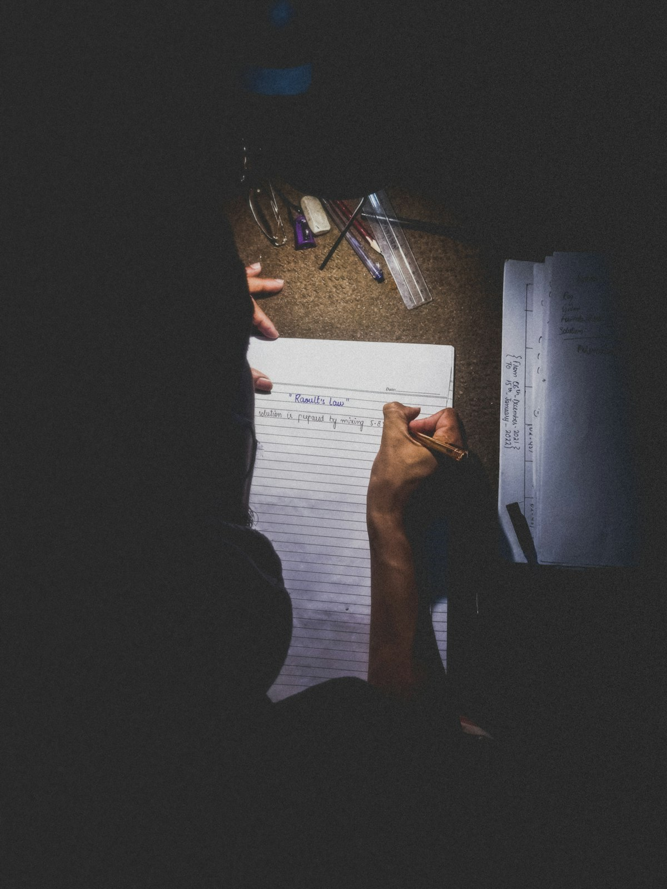
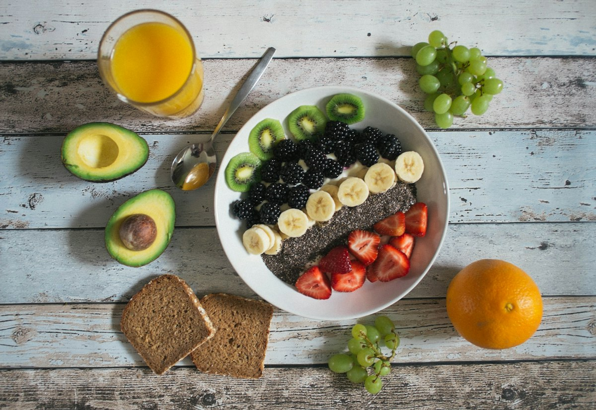
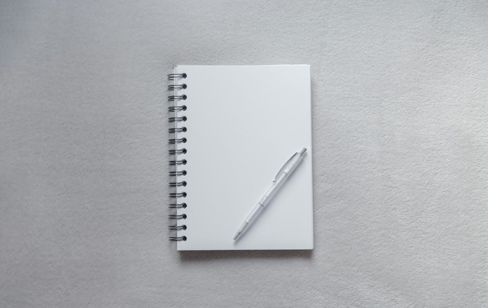
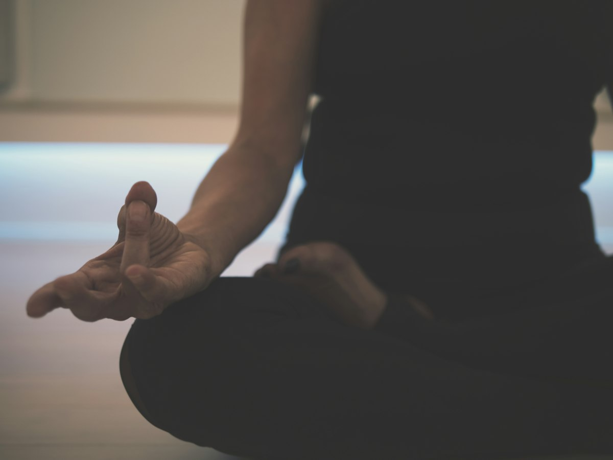

# 수능 D-19, 남은 3주 컨디션과 멘탈 관리 가이드 (수험생·학부모 체크리스트)

> 네이버 블로그 초안(임시저장, 발행 안 함). 원본 글은 한국어로 작성했으며, 이 파일은 영어 원고(`output/blog/csat-dday-condition-guide.md`)의 한국어 번역입니다. 이미지는 Unsplash(무료 라이선스)이며 `output/blog/images/`에 있습니다.

## [지금, D-19의 마음가짐]

오늘이 10월 31일, 언론 보도 기준으로 수능(11월 19일 목요일)까지 19일 남았습니다. 이 시기에는 불안해서 새 문제집을 사거나 계획을 통째로 바꾸고 싶어지기 쉽습니다. 하지만 지금 가장 중요한 것은 새로운 것을 더하는 일이 아니라, 이미 쌓아온 실력을 시험 당일에 그대로 꺼내 쓰도록 몸과 마음을 정리하는 일입니다. 오늘 할 일을 평소처럼 해내는 것만으로 충분합니다.

## [남은 2~3주, 수면·식사·루틴]

- 수면: 하루 6~8시간, 가능하면 자정 전 취침이 권장됩니다. 수면시간을 갑자기 늘리거나 줄이면 오히려 리듬이 깨질 수 있다는 서울성모병원 교수 조언이 보도되었습니다. 지금부터는 시험 당일 기상 시간에 맞춰 조금씩 일정하게 맞춰 가세요.
- 식사: 새로운 음식이나 기름진 보양식은 피하고 평소 먹던 음식 위주로 드세요. 야식, 과도한 카페인, 에너지음료는 줄이는 것이 좋습니다.
- 루틴: 1~2시간마다 가벼운 스트레칭으로 몸을 풀어 주세요. 공부 시간대도 실제 시험 시간표 흐름에 맞추면 몸이 적응하기 쉽습니다.

## [시험 전날 체크리스트]

전날에는 예비소집에서 수험표를 받고 시험장과 시험실 위치를 직접 확인합니다.
- 수험표와 실물 신분증을 가방에 넣었는지 확인
- 시계는 통신·결제·전자화면 기능이 없는 아날로그 시계만 안내되어 있으니 확인
- 휴대전화, 스마트워치, 스마트안경, 보조배터리 등은 반입 금지입니다. 세부 기준은 반드시 공식 안내로 확인하세요.
- 수험표를 분실했다면 원서 사진과 같은 사진 1매와 신분증을 가지고 당일 08:00까지 시험장 관리본부에 신고하면 재발급받을 수 있습니다.
- 새로운 문제를 풀기보다 오답 노트와 정리한 내용을 가볍게 훑고, 평소 시간에 잠자리에 드세요.

## [시험 당일 아침과 쉬는 시간]

식사는 시험 약 2시간 전에 마치고, 평소 먹던 음식을 평소의 3분의 2 정도로 가볍게 드시라는 서울아산병원 교수 조언이 있습니다. 속이 더부룩하면 집중이 흐트러지니 욕심내지 마세요.
입실 시간은 민간 정리글 기준으로 08:10 입실 완료, 1교시 08:40 시작이라고 알려져 있지만 공식 확인이 되지 않았습니다. 2~5교시는 시작 10분 전 입실이라는 자료도 있으나, 교시별 전체 시간표는 한국교육과정평가원 공식 안내에서 꼭 확인하세요. 여유 있게 도착하는 것이 가장 좋은 컨디션 관리입니다.
쉬는 시간에는 방금 본 과목을 채점하듯 되짚지 마세요. 이미 끝난 시험은 놓아 주고, 물을 마시고 가볍게 몸을 풀며 다음 교시 준비만 하면 됩니다. 가채점표 관련 규정은 공식 안내를 확인하세요.

## [긴장될 때 호흡법]

긴장되면 복식호흡을 해 보세요.
- 코로 천천히 숨을 들이마시며 배가 부풀어 오르는 것을 느낍니다.
- 들이마신 때보다 더 길게, 입으로 천천히 내쉽니다.
- 이것을 몇 차례 반복하며 어깨의 힘을 뺍니다.
만약 극도로 긴장해 어지럽다면 혼자 참지 말고 감독관에게 알리고 안정을 취하세요. 이는 의료진 조언을 바탕으로 한 일반적인 내용이며, 개인의 건강 상태에 따라 다를 수 있으니 걱정이 크다면 전문가와 상담하시기 바랍니다.

## [학부모 가이드]

하면 좋은 것
- 평소와 같은 평상심을 유지하기
- "그동안 애썼다"는 따뜻한 격려 한마디
- 여유 있게 출발해 입실 시간 내 도착하도록 돕기
- 전날 시험장 위치와 수험표 함께 확인하기
피할 것
- "실수하지 마라"를 강조하는 말
- 다른 학생과의 비교
- 건강에 대한 지나친 과민 반응
- 전날의 잔소리
부모님의 평온한 얼굴이 아이에게는 가장 든든한 응원입니다.

## [응원 마무리]

지난 시간 동안 하루하루 책상 앞을 지켜 온 것만으로 이미 대단한 일을 해냈습니다. 남은 19일은 잘 자고, 잘 먹고, 평소처럼 지내며 그 노력을 지켜 주는 시간입니다. 수험생 여러분과 곁에서 함께 마음 졸이는 부모님 모두, 11월 19일에 가진 힘을 편안하게 다 펼치고 오시기를 진심으로 응원합니다.

## 참고한 자료
- 2027학년도 수능 일정 및 성적 통지 관련 언론 보도
- 서울성모병원 교수 수면 조언 보도
- 서울아산병원 교수 식사 조언 보도
- 긴장 완화(복식호흡·스트레칭 등) 관련 의료진 조언 보도
- 수능 입실 시간 관련 민간 정리글 (공식 미확인)
- 수능 준비물·반입 금지 물품 및 학부모 유의사항 관련 안내 자료
- 이미지: Unsplash (unsplash.com)

※ 시험 일정과 준비물은 반드시 한국교육과정평가원 공식 안내를 확인하세요.
